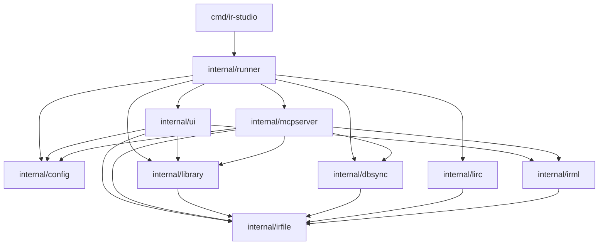

# `ir-studio` System Architecture & Visual Design Contract (`DESIGN.md`)

This document defines the **4-layer clean Go 1.27+ architecture**, **320×170 RGB565 visual design tokens**, **6-tab UI contract**, and **anti-god-file structural rules** for `ir-studio`.

---

## 1. 4-Layer Clean Architecture (Go 1.27+, `CGO_ENABLED=0`)

`ir-studio` follows a strict **hexagonal / clean 4-layer layout** with strictly **one-way dependencies** (outer adapters depend on inner domain contracts; pure domain packages have zero hardware, UI, or MCP imports).

```text
Layer 4: Entrypoint & Composition Root
├── cmd/ir-studio/main.go        # Thin entrypoint ONLY (<= 35 lines): flags, signal.NotifyContext, runner.Run
├── cmd/shots/main.go            # Headless 320x170 PNG screenshot generator for all 6 tabs + Help modal
└── internal/runner/             # Composition Root (DI): wires config, lirc/SIM, library, dbsync, UI or MCP

Layer 3: Inbound & Outbound Adapters
├── internal/config/             # Opt-in settings ($HOME/.config/ir-studio/config.json, 0600 atomic write)
├── internal/lirc/               # Outbound Hardware Adapter (/dev/lirc* ioctls, SIM, TransceiverGate, TX/RX workers)
├── internal/dbsync/             # Outbound Network Adapter (sources.json registry, ETag/SHA delta Syncer)
├── internal/mcpserver/          # Inbound Agent Adapter (JSON-RPC 2.0 stdio: server.go, backend.go, schema.go, tools_*.go)
└── internal/ui/                 # Inbound Human Adapter (320x170 /dev/fb0 + TCA8418 evdev: app.go, chrome.go, view_*.go)

Layer 2: Application / Library Services
└── internal/library/            # UserLibrary (RW), DatabasePack (RO), PromoteToUser, Macro store, ProbeSession

Layer 1: Pure Domain Core (Zero Hardware / UI / Network Imports)
├── internal/irfile/             # Flipper .ir v1 codec + ProtocolRegistry (NEC, NECext, Samsung32, RC5, RC6, SIRC, Kaseikyo, RAW)
└── internal/irml/               # On-device 0-alloc ML core (1D K-Means, FeatureVector, MLP classifier, FingerprintIndex)
```

### Dependency Direction Rules



- `internal/irfile` depends ONLY on the Go standard library.
- `internal/irml` depends ONLY on the Go standard library and `internal/irfile` value types.
- `internal/ui` MUST NEVER import `internal/lirc` concrete Linux ioctl types directly — it consumes narrow interfaces (`TXSubmitter`, `RXStream`, `TransceiverInfo`) injected by `internal/runner`.
- `internal/mcpserver` MUST NEVER access `/dev/lirc*` directly — it consumes a mutex-serialized `IRBackend` adapter injected by `internal/runner`.

### Package File Decomposition Blueprint

| Package | Focused Files (Each `<= 350` lines) |
| --- | --- |
| `cmd/ir-studio` | `main.go` |
| `internal/runner` | `runner.go`, `wiring.go` |
| `internal/config` | `config.go` |
| `internal/lirc` | `ioctl.go` (SSOT constants), `transport_linux.go`, `transport_stub.go`, `sim.go`, `gate.go`, `tx_worker.go`, `rx_worker.go`, `discover.go` |
| `internal/irfile` | `types.go`, `parser.go`, `writer.go`, `registry.go`, `proto_nec.go`, `proto_samsung.go`, `proto_rc5.go`, `proto_rc6.go`, `proto_sirc.go`, `proto_kaseikyo.go`, `proto_raw.go` |
| `internal/irml` | `denoise.go`, `cluster.go`, `features.go`, `mlp.go`, `fingerprint.go` |
| `internal/library` | `store.go`, `packs.go`, `promote.go`, `macro.go`, `probe.go` |
| `internal/dbsync` | `sources.go`, `syncer.go`, `state.go` |
| `internal/mcpserver` | `server.go`, `backend.go`, `schema.go`, `tools_rxtx.go`, `tools_library.go`, `tools_ml.go`, `tools_probe_macro.go`, `tools_system.go` |
| `internal/ui` | `app.go`, `state.go`, `chrome.go`, `fb.go`, `font.go`, `input.go`, `help.go`, `view_rx.go`, `view_remote.go`, `view_probe.go`, `view_saved.go`, `view_macro.go`, `view_settings.go` |

---

## 2. CardputerZero `320×170` RGB565 Visual Design System

### Screen Grid (`320×170` px)
- **Header (`y = 0..17`, height `18 px`)**:
  - App badge (`x = 4..48`): `IR-LAB` (Cyan text on `surface_alt`)
  - Active Tab pill (`x = 52..100`): `RX` / `REMOTE` / `PROBE` / `SAVED` / `MACRO` / `SET`
  - Carrier / Activity status (`x = 104..194`): e.g. `38kHz 33%` or `TX ACTIVE` / `RX LIVE`
  - Feature pills (`x = 198..268`): `ML` / `MCP` / `PROBE` compact badges
  - Hardware / SIM badge (`x = 272..316`): `LIRC0` (Emerald) or `SIM` (Amber)
- **Workspace (`y = 18..142`, height `125 px`)**:
  - Tab-specific viewport with `6 px` horizontal margins (`x = 6..314`, usable width `308 px`).
  - `1 px` divider lines using `border` (`#1e293b`); card panels using `surface` (`#121a23`) and `surface_alt` (`#182230`).
- **Bottom Nav Bar (`y = 143..169`, height `27 px`)**:
  - 5 keycap-labeled action tiles (`50×21 px`), centered vertically at `y = 153` and horizontally over physical keys `4..8` at exact centers `x = [49, 105, 161, 217, 273]`.
  - Each tile shows a small keycap badge (`4`..`8`) and a short English action label (`SAVE`, `TX`, `CLR`, `TAB`, `HELP`, etc.) contextual to the active tab.
- **Toast Overlay (`y = 22..37`)**:
  - Centered pill with `1 px` semantic border (`emerald` success, `amber` warning, `red` error, `cyan` info), auto-dismissing after `2 s`.

### Semantic Color Roles (RGB565 & Web Portal Parity)
- **Cyan (`#00d9ff`)**: Active cursor, selected tab, waveform mark bars, primary IR selection highlight.
- **Emerald (`#10e191`)**: Hardware connected (`LIRC0`), decoded structured protocol (`NEC`, `RC5`, etc.), `ENABLED` settings, `TX OK`, `PROMOTED` feedback.
- **Amber (`#f59e0b`)**: `SIM` mode badge, `DISABLED` opt-in settings (`MCP OFF`), `RAW`-only capture fallback, `PAUSE` state, carrier/duty warnings.
- **Magenta (`#e879f9`)**: On-device ML outputs (`ML-CLEAN`, cluster centroids, fingerprint match score, MLP confidence).
- **Red (`#ef4444`)**: Active `TX` emission indicator (`TX LIVE`), destructive confirmation prompt (`DEL?`), hardware/ioctl error badge.
- **Muted (`#94a3b8`)**: Space intervals, secondary metadata (address/command hex labels, read-only `DB` tag), idle states.

### Keyboard Ergonomics (46-key TCA8418)
- **`TAB`**: Cycle forward across the 6 tabs (`RX → REMOTE → PROBE → SAVED → MACRO → SET`).
- **`1`..`6`**: Direct tab jump (outside text-input mode).
- **`4`..`8`** (contextual when not jumping tabs, or mapped to bottom nav tiles via `F4`–`F8` / dedicated action keys): Trigger the 5 bottom-bar actions aligned at `x = [49, 105, 161, 217, 273]`.
- **`F` / `Z` / `X` / `C`**: Up / Left / Down / Right navigation outside text-input mode (mirrors physical arrow ergonomics without holding `fn`).
- **`Enter` / `Space`**: Primary contextual action (Send selected button, Toggle Pause/Run, Open remote, Toggle setting).
- **`ESC`**: Short press cancels active TX/Probe/Macro or closes modal (or exits from top level); long press returns to `APPLaunch` HOME.
- **`fn+H` / `?`**: Open paginated built-in Help modal (`helpPages`).

---

## 3. 6-Tab Studio Layout (`RX`, `REMOTE`, `PROBE`, `SAVED`, `MACRO`, `SET`)

| Tab | Primary Purpose | Workspace Content (`308×125 px`) | Bottom 5 Tiles (`x = 49, 105, 161, 217, 273`) |
| --- | --- | --- | --- |
| **`RX`** | Live IR capture, decode & ML inspection | Top: Decoded protocol banner (`NEC 04 00 / 08 00`) + ML confidence pill; Middle: `308×44 px` live mark/space pulse oscilloscope + timing centroids (`Short`/`Long` µs); Bottom: Capture metadata (carrier, pulse count, fingerprint match) | `HOLD` · `TX` · `SAVE` · `CLR` · `HELP` |
| **`REMOTE`** | Virtual button pad for active `.ir` file | Top: Active remote name + `[USER]`/`[RO-DB]` badge; Main: 2-column scrollable button grid (`Power`, `Vol+`, `Vol-`, `Mute`, `Ch+`, `Ch-`, etc.) with protocol/carrier footer for highlighted button | `TX` · `RPT` · `PROMO` · `EDIT` · `HELP` |
| **`PROBE`** | Universal Power-Off / brand sweep (`ProbeSession`) | Top: Pack & category (`TV Power`, `AC Power`, `Projector`) + state pill (`IDLE`/`RUN`/`PAUSE`/`DONE`); Middle: Progress bar (`042/180`), current signal name, interval (`0.25s`); Bottom: 12-slot `RecentSent` rewind strip | `RUN` · `INTV` · `REW` · `PROMO` · `HELP` |
| **`SAVED`** | Dual-scope library browser (`UserLibrary` vs `DatabasePack`) | Left/Top scope toggle (`USER` RW vs `DB PACKS` RO); Scrollable list of `.ir` remotes with button counts and pack badges; guarded `DEL` only enabled on `USER` items | `OPEN` · `SCOPE` · `SYNC` · `DEL` · `HELP` |
| **`MACRO`** | Multi-step IR sequence runner & editor | Top: Macro name + step counter; Main: Ordered list of `MacroStep` rows (`01 TV:Power  500ms`, `02 AMP:HDMI1  200ms`); Footer: Live step execution bar | `RUN` · `ADD` · `DELAY` · `DEL` · `HELP` |
| **`SET`** | Hardware, LIRC & opt-in MCP settings | Scrollable key-value rows: `LIRC Device` (`/dev/lirc0` / `AUTO`), `Default Carrier` (`38 kHz`), `Duty Cycle` (`33%`), `RX Timeout` (`15 ms`), `SIM Mode`, **`MCP Server` (`DISABLED` default)**, `DB Sources` | `TOGL` · `RESCAN` · `RESET` · `SAVE` · `HELP` |

---

## 4. Anti-God-File & Code Quality Rules (Mandatory)

1. **File Size Cap**: Target **`<= 350` lines** per non-test source file. Refactor immediately if any non-generated file exceeds `~400` lines.
2. **Function Size Cap**: Target **`<= 40` lines** per function/method. Extract every non-trivial calculation, validation, protocol bit-packing step, or widget draw pass into a clearly named function/method.
3. **Struct Composition Cap**: Keep structs **`<= 10–12` fields**. Group state into cohesive domain sub-structs (`RXState`, `RemoteState`, `ProbeState`, `SavedState`, `MacroState`, `SettingsState`) and compose/embed them cleanly.
4. **SOLID & DI**:
   - **Single Responsibility**: Each file and type has one reason to change.
   - **Open/Closed**: New IR protocols register into `irfile.ProtocolRegistry`; new MCP tools register into `mcpserver.Registry`; new UI tabs implement a `TabView` interface.
   - **Interface Segregation & DI**: Inject `lirc.Transport`, `io.Reader`/`io.Writer`, clock/timers, and config/library root paths via constructors so 100% of packages are unit-testable without physical hardware.
5. **SSOT (Single Source of Truth)**:
   - LIRC ioctl constants live ONLY in `internal/lirc/ioctl.go`.
   - Protocol timing specs live ONLY in their respective `internal/irfile/proto_*.go`.
   - MCP JSON schemas live ONLY in `internal/mcpserver/schema.go`.
   - Default settings live ONLY in `internal/config/config.go`.
6. **Modern Go 1.27+ Idioms**:
   - Use `CGO_ENABLED=0`, `for range n`, `slices.SortFunc` + `cmp.Compare`, `min`/`max`, `clear()`, `strings.Cut`, `strings.SplitSeq`, `for b.Loop()` in benchmarks, and fixed-size stack arrays for bounds-check elimination on ML hot paths.
7. **Verification Standard**:
   - Table-driven adversarial Go tests (`go test -race -cover ./...`) aiming for **`90%+` coverage** on all new packages.
   - Standard library `testing` only (no third-party assertion frameworks).
   - Fuzz tests (`Fuzz*`) for all parsers and decoders; benchmarks (`Benchmark*`) asserting `0 allocs/op` on `internal/irml` hot paths.
   - Non-root execution only: `/dev/lirc*`, `/dev/fb0`, `/dev/input/*` accessed via Linux device groups (`lirc`, `video`, `input`) and udev rules.
