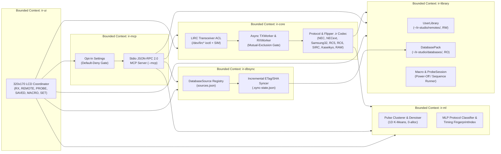

# `ir-studio` Domain Model & Bounded Contexts (`DOMAIN.md`)

This document is the authoritative **Domain-Driven Design (DDD)** contract for `ir-studio`, the pure-Go 38 kHz Infrared studio application for M5Stack CardputerZero (`320×170` RGB565 `/dev/fb0`, 46-key TCA8418 keyboard, Linux `/dev/lirc*`, ARM64 `CGO_ENABLED=0`).

All engineers and AI agents working on `ir-studio` MUST preserve the **Bounded Contexts**, **Domain Invariants**, and **Ubiquitous Language** defined below.

---

## 1. Context Map

---

## 2. Bounded Contexts, Responsibilities & Invariants

### Context 1: `ir-core` (`internal/lirc`, `internal/irfile`)
- **In Scope**: Linux `/dev/lirc*` hardware discovery and pure-Go `ioctl` control (`LIRC_MODE_PULSE` TX, `LIRC_MODE_MODE2` RX, carrier frequency `36–56 kHz`, duty cycle `1–99%`), deterministic `SIM` fallback transceiver, Flipper Zero `.ir` v1 multi-button file parser/serializer, structured IR protocol encoders/decoders (`NEC`, `NECext`, `Samsung32`, `RC5`, `RC6`, `SIRC`, `Kaseikyo`, `RAW`), asynchronous `TXWorker` and `RXWorker` with optical mutual exclusion.
- **Out of Scope**: Sub-GHz RF (`rf-heatmap`), 13.56 MHz NFC (`nfc-studio`), CGO / `liblirc_client`, shelling out to `ir-ctl` or `mode2` binaries.

### Context 2: `ir-library` (`internal/library`)
- **In Scope**: Strict separation between read-write `UserLibrary` (`~/ir-studio/remotes/`) and read-only external `DatabasePack`s (`~/ir-studio/databases/<pack>/`), `Remote` and `IRSignal` aggregate loading/indexing, `PromoteToUser` copy workflow, `Macro` multi-step IR sequence persistence and execution state, and `ProbeSession` (Universal Power-Off / brand sweep state machine with `RecentSent` rewind markers).
- **Out of Scope**: Network HTTP fetching (owned by `ir-dbsync`) and framebuffer rendering (owned by `ir-ui`).

### Context 3: `ir-ml` (`internal/irml`)
- **In Scope**: Pure-Go, zero-dependency, zero-allocation hot-path on-device signal intelligence: 1D K-Means pulse-width clustering and glitch absorption (`DenoisePulses`), fixed-size `[12]float32` `IRFeatureVector` extraction, lightweight MLP protocol/modulation family classification, L2-normalized `[8]float32` `IREmbedding` timing fingerprint matching (`IRFingerprintIndex`), and repeat-frame / carrier-jitter scoring.
- **Out of Scope**: Python/ONNX/TFLite runtimes, cloud inference, hardware I/O.

### Context 4: `ir-dbsync` (`internal/dbsync`)
- **In Scope**: Remote `.ir` database source registry (`$HOME/.config/ir-studio/sources.json`), incremental ETag / SHA-256 delta `Syncer` populating read-only `~/ir-studio/databases/<id>/` with `.sync-state.json`, atomic file replacement, and bounded download/concurrency limits.
- **Out of Scope**: Modifying `UserLibrary` (`~/ir-studio/remotes/`).

### Context 5: `ir-mcp` (`internal/config`, `internal/mcpserver`)
- **In Scope**: User opt-in settings persisted at `$HOME/.config/ir-studio/config.json` (`0600` atomic write) and pure-Go JSON-RPC 2.0 stdio MCP server (`ir-studio --mcp`) exposing hardware RX/TX, protocol decode/encode, ML analysis, library/macro/probe inspection, and DB sync tools via a mutex-serialized `IRBackend` adapter.
- **Out of Scope**: Running as root, binding to non-loopback interfaces, bypassing user opt-in.

### Context 6: `ir-ui` (`internal/ui`, `internal/runner`, `cmd/ir-studio`)
- **In Scope**: `320×170` RGB565 `/dev/fb0` renderer, 46-key TCA8418 `evdev` keyboard handler, 6-tab studio (`RX`, `REMOTE`, `PROBE`, `SAVED`, `MACRO`, `SET`), built-in Help modal, toast notifications, and `cmd/shots` screenshot harness.
- **Out of Scope**: Inline protocol math, direct LIRC `ioctl` syscalls, blocking hardware I/O on the render loop.

---

## 3. Domain Invariants (NEVER Violate)

1. **LIRC Carrier/Duty Restoration Invariant**:
   - Every TX operation that configures carrier frequency (`LIRC_SET_SEND_CARRIER`, valid range `36000–56000 Hz`, default `38000 Hz`) or duty cycle (`LIRC_SET_SEND_DUTY_CYCLE`, valid range `1–99%`, default `33%`) MUST unconditionally restore the hardware defaults (`38000 Hz`, `33%`) and ensure the IR LED is dark (idle) upon completion, `context.Context` cancellation, or error.
2. **TX/RX Mutual Exclusion Invariant**:
   - An IR emitter and co-located IR receiver photodiode MUST NOT operate simultaneously (preventing self-blinding optical loopback and `/dev/lirc*` contention). `TXWorker` and `RXWorker` MUST synchronize through a shared `TransceiverGate`: before transmitting, `RXWorker` is paused/muted; after TX finishes, the gate enforces an optical settle guard (`>= 20 ms`) before resuming RX.
3. **Sign / Mark-Space Alternation Invariant**:
   - Internal `PulseTrain` slices MUST strictly alternate positive mark (`+µs`) and negative space (`-µs`) durations (`p[i] != 0` and `(p[i] > 0) != (p[i-1] > 0)`).
   - Outbound LIRC `LIRC_MODE_PULSE` arrays MUST have odd length (`len % 2 == 1`), starting and ending with a mark, containing strictly positive `uint32` microsecond durations clamped to `[MinPulseUs, MaxPulseUs]`.
   - `DenoisePulses` MUST absorb sub-threshold EMI glitches (`< GlitchMaxUs`) into adjacent pulses rather than deleting them blindly and collapsing two same-sign pulses.
4. **External-DB Read-Only Invariant**:
   - `UserLibrary` (`~/ir-studio/remotes/`) and external `DatabasePack`s (`~/ir-studio/databases/<pack>/`) MUST remain strictly isolated. `DEL`, `RENAME`, and `PURGE` operations MUST NEVER modify or delete files in any `DatabasePack`.
   - Winning signals discovered during `PROBE` or external browsing are copied into `UserLibrary` exclusively via `PromoteToUser`.
5. **Default-Deny MCP Invariant**:
   - `Settings.MCPEnabled` MUST default to `false`.
   - Invoking `ir-studio --mcp` while `mcp_enabled == false` MUST exit non-zero with a clear English message instructing the user to enable MCP in the `SET` tab.
   - MCP TX tools MUST require explicit `confirm_tx: true` and cap repeat counts (`<= 10`); destructive delete tools MUST require `confirm: true` and enforce path sandboxing strictly inside `UserLibrary` (rejecting `..`, `/`, `\`).
6. **Zero-Allocation ML Hot Path Invariant**:
   - `ClusterPulses`, `ExtractFeatures`, `ClassifyProtocol`, and `IRFingerprintIndex.Match` MUST execute with `0` heap allocations (`0 B/op, 0 allocs/op`) using fixed-size stack arrays (`[12]float32`, `[8]float32`) and caller-owned scratch slices.
7. **UI Non-Blocking Invariant**:
   - All LIRC I/O, protocol brute/probe sweeps, macro delays, and DB sync HTTP calls MUST run on background goroutines communicating via bounded channels. The `~55 ms` UI render/input loop MUST NEVER block on hardware or network I/O.

---

## 4. Ubiquitous Language (Canonical Glossary — Do NOT Substitute)

*Engineers and agents MUST use these exact domain terms in Go types, methods, JSON schemas, UI labels, and documentation. Never replace them with generic synonyms.*

| Domain Term | Exact Meaning | Forbidden Generic Synonyms |
| --- | --- | --- |
| **`Transceiver`** | Hardware/SIM abstraction over `/dev/lirc*` supporting `LIRC_MODE_PULSE` TX and `LIRC_MODE_MODE2` RX. | `DeviceHelper`, `IRManager` |
| **`TransceiverGate`** | Mutex + pause/resume coordinator enforcing TX/RX mutual exclusion and the `>= 20 ms` post-TX optical settle guard. | `LockHelper`, `SyncUtil` |
| **`PulseTrain`** | Ordered slice of signed microsecond durations (`+mark µs`, `-space µs`) satisfying strict sign alternation. | `RawData`, `TimingsList` |
| **`CarrierSpec`** | Value object holding carrier frequency (`FreqHz`, `36000–56000 Hz`) and duty cycle (`DutyPct`, `1–99%`). | `TxConfig`, `Params` |
| **`IRSignal`** | Single named IR command inside a Flipper `.ir` file (`Name`, `Kind` `Parsed`/`Raw`, `Protocol`, `Address [4]byte`, `Command [4]byte`, `CarrierSpec`, `RawData []uint32`). | `ButtonData`, `Item` |
| **`Remote`** | Aggregate representing a multi-button Flipper `.ir` file (`Name`, `SourcePack`, `ReadOnly`, `Signals []IRSignal`). | `FileEntry`, `RemoteData` |
| **`ProtocolCodec`** | Strategy interface (`Name()`, `Encode(IRSignal)`, `Decode(PulseTrain)`) implemented per IR protocol (`NEC`, `NECext`, `Samsung32`, `RC5`, `RC6`, `SIRC`, `Kaseikyo`, `RAW`). | `ParserUtil`, `Converter` |
| **`TXWorker`** | Background goroutine executing queued `TXRequest`s with `context.Context` cancellation and guaranteed carrier/duty restoration. | `SenderThread`, `TxHelper` |
| **`RXWorker`** | Background goroutine framing `LIRC_MODE_MODE2` packets into `RXCapture` events without blocking UI rendering. | `ReaderLoop`, `Listener` |
| **`RXCapture`** | Immutable snapshot of a received IR frame (`Timestamp`, `Pulses PulseTrain`, `Decoded *IRSignal`, `Classification`, `CarrierEstHz`). | `RxResult`, `Packet` |
| **`PulseClusters`** | 1D K-Means timing centroids (`ShortUs`, `LongUs`, `HeaderUs`, `JitterRatio`, `GlitchesRemoved`). | `ClusterData`, `Stats` |
| **`IRFeatureVector`** | Normalized `[12]float32` stack-allocated input to the on-device MLP protocol/modulation classifier. | `Inputs`, `Metrics` |
| **`IREmbedding`** | L2-normalized `[8]float32` timing signature used by `IRFingerprintIndex` for near-duplicate remote matching. | `Hash`, `Vector` |
| **`UserLibrary`** | Read-write local `.ir` remote directory (`~/ir-studio/remotes/`) owned exclusively by the user. | `LocalFolder`, `Files` |
| **`DatabasePack`** | Read-only external `.ir` pack directory (`~/ir-studio/databases/<pack>/`), protected from deletion/modification. | `ExternalList`, `RepoDir` |
| **`PromoteToUser`** | Explicit copy operation migrating a winning `IRSignal` or `Remote` from a read-only `DatabasePack` into `UserLibrary`. | `SaveCopy`, `Clone` |
| **`ProbeSession`** | Universal Power-Off / brand sweep state machine (`IDLE`/`RUN`/`PAUSE`/`DONE`) with configurable interval and 12-slot `RecentSent` rewind markers. | `AutoRunner`, `BruteLoop` |
| **`Macro` / `MacroStep`** | Ordered sequence of `(RemoteRef, SignalName, DelayMs, Repeat)` steps executed asynchronously with instant cancel. | `Script`, `Playlist` |
| **`DatabaseSource` / `Syncer`** | Remote `.ir` source registry (`~/.config/ir-studio/sources.json`) and incremental ETag/SHA delta downloader writing `.sync-state.json`. | `Downloader`, `Updater` |
| **`Settings`** | User-persisted opt-in configuration (`$HOME/.config/ir-studio/config.json`, `0600`) including default-deny `MCPEnabled`. | `AppConfig`, `Prefs` |

---

## 5. Entities, Value Objects & Struct Composition Rules

- **Value Objects (immutable, stack-allocated where possible, no side effects)**:
  `CarrierSpec`, `IRSignal`, `RXCapture`, `TXRequest`, `TXEvent`, `PulseClusters`, `IRFeatureVector`, `IREmbedding`, `MatchResult`, `MacroStep`, `Settings`.
- **Stateful Domain Services / Aggregates**:
  `Remote`, `ProtocolRegistry`, `TransceiverGate`, `TXWorker`, `RXWorker`, `IRFingerprintIndex`, `ProbeSession`, `UserLibrary`, `Syncer`.
- **Struct Composition over Flat God Structs**:
  - No struct may exceed `~10–12` flat fields.
  - `ui.App` MUST compose focused domain sub-structs: `RXState`, `RemoteState`, `ProbeState`, `SavedState`, `MacroState`, `SettingsState`, and `ChromeState`.
- **Anti-Corruption Layers (ACL)**:
  - `lirc.Transport` isolates Linux `/dev/lirc*` `ioctl`/`poll`/`read`/`write` syscalls from `TXWorker`/`RXWorker` logic.
  - `mcpserver.IRBackend` isolates MCP JSON-RPC tool handlers from hardware workers and filesystem stores.

---

## 6. AI Guardrails & Anti-Patterns

- **DO NOT** embed protocol timing tables, ioctl bitmasks, or ML math inside `internal/ui` or `internal/mcpserver`.
- **DO NOT** create catch-all packages or types named `utils`, `helpers`, `common`, `manager`, or `misc`.
- **DO NOT** cross bounded contexts by importing `rf-heatmap` or `nfc-studio` into `ir-studio` (or vice versa).
- **DO NOT** shell out to `ir-ctl`, `lircd`, or `mode2` — all LIRC communication MUST be pure Go (`CGO_ENABLED=0`).
